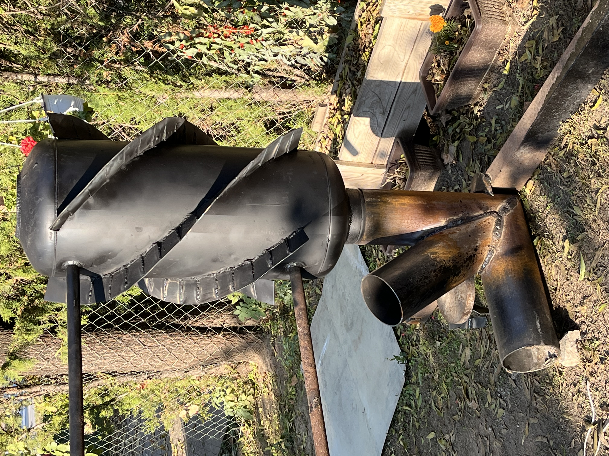

# STIRB Rocket Boiler

## An Open-Source Heating Innovation

**Original concept and design: Bojan Štirb, Serbia**  
**Project: STIRB Innovations**

### About STIRB

STIRB is the family name of its inventor, Bojan Štirb. The name preserves the connection between the original concept and its creator.

STIRB Rocket Boiler is an experimental solid-fuel central heating concept that uses four extended spiral flue-gas channels to explore improved heat transfer to a water-based heating system.

### Development and Testing

Gas flow through the extended channels has been tested by the project author, with no observed flow problems under the tested conditions.

Quantitative efficiency and safety validation have not yet been documented.

### Project Mission

The goal is to share engineering knowledge openly, allowing engineers, researchers, students and enthusiasts worldwide to study, test and improve the STIRB concept.

### STIRB Rocket Boiler – 3D Design

The following image presents the current design concept of the STIRB Rocket Boiler.

**Design Revision – Upper Water Connection and Air Venting**

In this design revision, the upper water connection has been relocated to the highest point of the boiler.

The purpose of this modification is to facilitate the removal of accumulated air from the water circuit and reduce the possibility of trapped air pockets in the upper section of the boiler.

The effectiveness of this arrangement and the requirements for additional air-venting and safety components remain subject to engineering verification.

### Design Development and Revision History

STIRB is an evolving experimental engineering project.

Design modifications will be documented to explain the technical reasoning behind each change.

**Documented design modification:**

- **Upper water connection relocation:** The upper connection has been moved to the highest point of the boiler to facilitate air removal from the water circuit.

Future revisions may address heat transfer, combustion gas circulation, hydraulic performance, maintenance and safety.

### 3D Models and Technical Documentation

Blender 3D models and concept images are available in this repository for technical examination and collaborative development.

Technical drawings, testing records and further design revisions will be published as they become available and are reviewed.

The available models represent experimental design concepts and should not be treated as validated manufacturing instructions.

### Open Engineering Collaboration

STIRB welcomes collaboration from engineers, researchers, students and technology enthusiasts worldwide.

Contributors are encouraged to:

- Examine the existing 3D models and engineering concept.
- Suggest improvements to heat transfer and flue-gas circulation.
- Evaluate the hydraulic design and air-venting arrangements.
- Propose improvements to operational safety and maintainability.
- Share engineering analyses, simulations and experimental findings.
- Participate in technical discussions and contribute design revisions.

The goal is to develop STIRB through open engineering collaboration, technical evaluation and practical experimentation.

### License

STIRB Rocket Boiler is an open-source hardware project.

Original hardware design files explicitly identified as covered by this licence are released under the CERN Open Hardware Licence Version 2 – Strongly Reciprocal (CERN-OHL-S-2.0).

The licence permits use, study, modification, manufacture and distribution under its terms, including applicable source-sharing obligations.

Copyright © 2026 Bojan Štirb.

The name STIRB originates from the inventor's family name.

For full licence terms, see LICENSE.

For inventor attribution and project information, see NOTICE.

### Safety Notice

This project involves solid-fuel combustion, hot flue gases and a water-based heating system.

Improper construction or operation may cause fire, carbon monoxide exposure, burns, overheating or dangerous pressure buildup.

Appropriate engineering design, ventilation, pressure protection, thermal safety systems and professional assessment are essential.

The published concept is experimental and is not a certified or validated construction guide.

### Attribution

**STIRB Rocket Boiler – Original concept by Bojan Štirb, Serbia.**

Part of **STIRB Innovations**.

*Open Engineering. Shared Knowledge. Continuous Improvement.*
